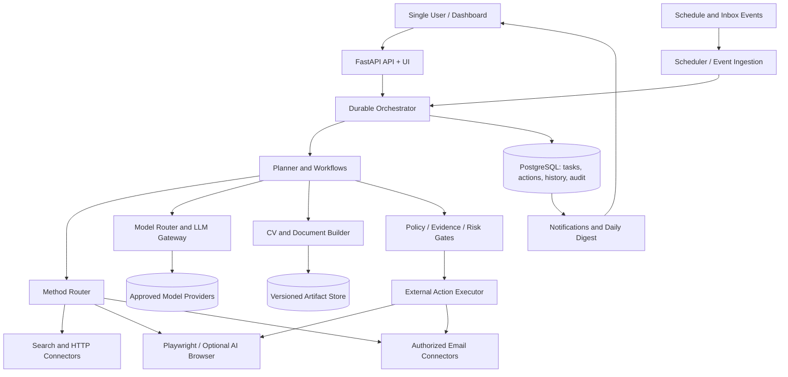

# Autonomous Career Opportunity Agent (ACOA)
## L3 — Technical Architecture & System Design / Teknik Mimari ve Sistem Tasarımı

| Alan | Değer |
|---|---|
| Doküman kodu | `ACOA-L3` |
| Sürüm | `v1.0` — onaylı mimari kararlar konsolidasyonu |
| Tarih | 2026-10-14 |
| Durum | **L3 mimari karar temeli onaylandı: ADR-001…ADR-015**. Uygulama ve üretim testi L4 kapsamında henüz yapılmadı. |
| Onaylı üst belgeler | `ACOA-L0`, `ACOA-L1`, **`ACOA-L2 v0.3 (approved baseline)`** |
| Kapsam | Tek kullanıcıya yönelik onaylı mimari, teknik sınırlar, 15 ADR, gereksinim izleri, uygulama kapıları ve L4 geçiş sözleşmesi |
| Kapsam dışı | Tam kaynak kod, migration SQL, gerçek kimlik bilgileri, üretim konfigürasyonu, L4 sprint/task planı |

> **Hiyerarşi notu:** Doküman seviyeleri `L0–L4`, model işlem sınıfları ise `T0–T3` olarak adlandırılır. Bu iki kavram aynı değildir.
>
> **Bağlayıcılık:** L2'de onaylı `K-01`, `P-01…P-22` ve `X-01…X-10` kuralları bu belgedeki teknik önerilerden üstündür. Belirsizlikte **fail-closed**; planlama/araştırma devam edebilir, dış gönderim gerçekleşmez.

---

## 1. Mimari hedefler ve kısıtlar

### 1.1. Tasarım önceliği

1. **Güvenli dış eylem:** Kullanıcı yetkisi, alıcı, kanal, veri, hedef, bütçe ve gönderim kanıtı tek işlem zincirinde doğrulanmalı.
2. **Gerçek otonomi:** Agent yeni araştırma/başvuru stratejileri planlayabilmeli; ancak otonomi yeni yetki vermez.
3. **Operasyonel güvenilirlik:** Kesinti sonrası devam edebilen, sonuç belirsizliğinde kör tekrar yapmayan bir çalışma düzeni.
4. **Kaliteye bağlı verimlilik:** Deterministik yöntem önceliği; LLM yalnız gerektiğinde; göreve göre model seçimi.
5. **Basitlik:** Tek kullanıcı için gereksiz microservice, tenant, broker ve ayrı agent süreçleri kurmamak.
6. **Değiştirilebilirlik:** Model, e-posta sağlayıcısı, arama kaynağı ve tarayıcı kontrolü adaptörler üzerinden değiştirilebilmeli.
7. **Kanıta dayalı ölçüm:** Doğrulanmış ilan/şirket, gönderim denemesi/harici kabul, e-posta gönderimi/teslimi farklı semantik taşımalı.

### 1.2. Kesin sınırlar

- Kişisel tek kullanıcılı sistem. Ekip rolleri, abonelik, tenant ve SaaS mimarisi **yok** (`K-01`).
- İlk başvuru ve ilk kurumsal iletişim, **önceden verilen ve koşulları karşılayan yetkilerle** otomatik olabilir.
- İşveren yanıtına **cevap** ve yanıtsız başvuruya **takip** yalnız taslak: kullanıcı kendisi gönderir (`P-01`, `P-02`).
- Doğrulanmamış profil iddiası otomatik CV'ye girmez. Yeni iddia ancak onaydan sonra doğrulanmış bilgiye dönüşür (`P-05`, `P-18`).
- CAPTCHA, MFA, giriş koruması, kaynak kısıtlamaları veya hukuki taahhütler otomatik atlatılamaz (`P-07`, `P-19`).
- Kişisel veri kullanma yetkisi, o veriyi dışarı paylaşma yetkisi değildir (`P-17`).
- Eksik zorunlu bütçe/kota/izin konfigürasyonunda dış gönderim **kapalı**dır (`P-04`, `P-10`).
- Agent kendi kodunu kalıcı olarak değiştiremez; yalnız kısıtlı izolasyonda geçici yardımcı araç çalıştırabilir (`P-14`).

## 2. Mimari alternatifler ve karar

| Alternatif | Avantaj | Dezavantaj | Karar |
|---|---|---|---|
| Tek Python scripti | Başlaması kolay | İşlem kaydı, test ve kurtarma zor | Reddedildi |
| **Modüler monolit + ayrı worker süreçleri** | Açık sınırlar, tek deployment, sağlam test, makul işletim | Disiplinli modül sınırları gerekir | **Önerildi** |
| Çoklu microservice / message bus | Bağımsız ölçekleme | Tek kullanıcı için aşırı operasyonel yük | Şimdilik reddedildi |
| Her fonksiyon için ayrı LLM agent | Kavramsal ayrışma | Fazla koordinasyon/token, tutarsızlık riski | Reddedildi |
| Özel Python durum makinesi + PostgreSQL görev kaydı | Dış eylem kuralları üzerinde doğrudan kontrol | İş akışı motoru uygulama disiplini gerekir | **Başlangıç seçimi** |
| LangGraph kalıcı checkpointer | Graph state, kesinti sonrası devam, insan müdahalesi | Ayrı checkpoint ile iş kaydı tutarlılığı tasarlanmalı | Daha sonra ölçülerek değerlendirilecek |
| Temporal | Güçlü durable workflow, replay ve schedule | Tek kullanıcı için ek sunucu/operasyon, replay kuralları | Gerekirse yükseltme alternatifi |

**ADR-001 / Approved:** Tek repository içinde modüler monolit; `api`, `scheduler`, `worker` ayrı *process* olabilir fakat aynı Python paketini ve veritabanını kullanır. Redis/Celery/Kafka başlangıç koşulu değildir. Mimari gereksinim büyürse yeniden değerlendirilir.

**ADR-002 / Approved:** Uygulamanın iş gerçeği (başvuru, izin, gönderim, geçmiş) **PostgreSQL**'de tutulur. Bir agent framework'ünün state/checkpoint deposu bu kaydın yerine geçmez.

## 3. Bağlam ve üst düzey mimari



**Kritik sınır:** `Search/HTTP/Browser/LLM` gözlem ve öneri yapabilir. **Harici kalıcı yan etki** (ilk e-posta, form gönderme, hesap oluşturma, belge yükleme) yalnız **External Action Executor** üzerinden; Executor, gerçek işlemden *hemen önce* `Policy Gate` ve `Budget Gate` doğrular. Rastgele oluşturulmuş scriptler bu kapıyı atlayamaz.

### 3.1. Dağıtılabilir çalışma süreçleri

- **`api`**: Kullanıcı arayüzü, yapılandırma, izin ve görev kontrol uçları; LLM işlemleri burada uzun süre tutulmaz.
- **`scheduler`**: Birikmiş ve zamanı gelmiş görevleri DB'ye güvenle ekler, e-posta olaylarını/polling sonuçlarını alır.
- **`worker`**: İşlem durum makinelerini sürdürür; araştırma/LLM işlemleri için sınırlı paralellik uygular.
- **`browser-worker`** *(isteğe bağlı ayrı izolasyon)*: Tarayıcı işlemleri ve dosya yüklemelerinin ayrı process/container içinde çalışması.
- **`sandbox-worker`** *(yalnız P-14 etkinse)*: Geçici kodun sıkı sınırlarla yürütülmesi; dış iletişim yetkisi doğrudan verilmez.

Bu süreçler **beş farklı AI agent** değildir; çoğu deterministik servis/worker'dır. İlk sürümde fiziksel olarak `api` ve `worker+scheduler` iki process'e kadar indirgenebilir.

### 3.2. ADR-011 — Ortamdan bağımsız dağıtım (onaylı)

- Aynı uygulama kaynak kodu ve imajları **yerel Windows/WSL2/Docker** veya **bulut VPS/VM/Docker** üzerinde çalıştırılabilir; yalnız konfigürasyon, gizli anahtarlar ve altyapı adresleri ortam bazında değişir.
- Dağıtım birimleri Docker Compose / eşdeğer: `acoa-api`, `acoa-worker` (zamanlayıcı gerektiğinde aynı süreçte), `acoa-postgres` (ACOA'ya özel), izole `acoa-browser-worker` ve yalnız yetkilendirildiğinde açılan `acoa-sandbox-worker`.
- Kod ve imajların taşınabilirliği **aynı anda iki yerde otomatik aktif çalışma** anlamına gelmez. Taşıma öncesi eski aktif worker kapatılır; DB + belge deposu birlikte yedeklenip bütünlük doğrulamasıyla geri alınır; tek aktif deployment ve migration sürümü denetlenir.
- Konfigürasyonlar platform bağımsız şemayla doğrulanır. Gerçek secret ve OAuth tokenleri `.env.example` dosyasına veya Git deposuna yazılmaz.

### 3.3. ADR-012 — Risk bazlı izolasyon (onaylı)

| Güven sınırı | Çalıştırma biçimi | Yasak / koruma |
|---|---|---|
| Normal veri, planlama, uygunluk, model yönlendirme | Paylaşılan ana worker, sınırlı concurrency | Dış eylem için doğrudan provider yazımı yok |
| Tarayıcı etkileşimi | Ayrı browser-worker/container; izole tarayıcı bağlamı | Yalnız görev için gerekli oturum/veri, egress ve dosya sınırları |
| AI tarafından oluşturulan geçici araç | Ayrı kısa ömürlü sandbox; salt okunur uygulama imajı | Secret, DB yazımı, doğrudan internet/gönderim ve ana koda yazma erişimi varsayılan kapalı |
| İlk başvuru / ilk iletişim / hesap oluşturma | Merkezi Policy Gate + External Action Executor | Doğrulanmış yetki, alıcı, belge, bütçe ve tekrar kontrolleri atlanamaz |

İzolasyonun uygulanabilirliği işletim sisteminin ve container runtime'ın imkânlarıyla doğrulanır. Sandbox için yalnız Docker kullanımı tek başına mutlak güvenlik garantisi kabul edilmez.

### 3.4. ADR-013 — Bağımsız PostgreSQL servisi (onaylı)

- `acoa-postgres` yalnız ACOA'ya hizmet veren ayrı container/servistir; kendi DB kullanıcısı, DB volume'u, yedekleme/geri yükleme ve migration yaşam döngüsü vardır.
- Diğer projelerin veritabanı servisine bağlanmak veya onların credential'larını kullanmak **yasaktır**. Uygulamanın DB yetkileri asgari düzeyde tutulur; migration yetkisi ayrı ele alınır.
- Veritabanı yönetim portu varsayılan olarak halka açık olmaz; uygulama ve yetkili bakım süreçleriyle kısıtlı ağda konuşur.
- Uygulama verilerinin ana doğruluk kaynağı PostgreSQL'dir; dosya içerikleri ayrı volume'da bulunur, ancak sürüm/hash/ilişki ve kanıt indeksleri DB'ye bağlıdır.

## 4. Sorumluluk sınırları ve agent topolojisi

### 4.1. Mantıksal modüller

| Modül | Tek sorumluluk | L1/L2 bağlantısı |
|---|---|---|
| Profile & Goals | Onaylı iddialar, hedefler ve sert kısıtlar | F-01, P-18 |
| Discovery | Kaynak ve aday şirket/fırsat sinyali | F-02, F-03 |
| Company Intelligence | Kurum, kurumsal kişi/kanal ve dolandırıcılık kanıtı | F-04, P-08, P-16 |
| Matching & Prioritization | Çok ölçütlü uygunluk, sıralama ve belirsizlik | F-05, P-03 |
| Strategy Planner | İlk temas/başvuru yolu, alternatif ve araştırma deneyleri | F-06, P-13 |
| Application Composer | Yalnız onaylı iddialardan CV/ön yazı/form cevapları | F-07, P-05, P-06 |
| Interaction Executor | API/e-posta/web işlemleri, kanıt toplama | F-08, P-07, P-11, P-19 |
| Inbox & Follow-up | Sınıflandırma, taslak, opt-out, bildirim | F-09, P-01, P-02 |
| Application Ledger | Başvuru kimliği, durum, idempotency, yeniden başvuru | F-10, P-15 |
| Scheduler & Notifications | Olay/zaman tetikleri, günlük özet | F-11, P-09, P-12 |
| Dashboard | Profil, izin, iş, maliyet, kontrol | F-12, P-22 |
| Policy / Audit / Cost / Evaluation | Tüm modüllere çapraz güvenlik ve kalite hizmetleri | E-01…E-12 |

### 4.2. Kaç tane AI agent?

**Başlangıç topolojisi: 1 adet orkestrasyon rolü + gerektiğinde çağrılan uzmanlaşmış karar profilleri.** Ayrı model process'leri ve birbirine konuşan çoklu ajanlar başlangıçta **zorunlu değildir**.

- **Planner**: Hedefi `TaskPlan`/`ActionPlan` hâline getirir; araç seçimi önerir; izin vermez.
- **Research role**: Şirket/iş fırsatı hakkında belirli kanıtları çıkarır; gerektiğinde LLM kullanır.
- **Application role**: Onaylı profilden CV/ön yazı ve açık sorular için taslak oluşturur; gerektiğinde LLM kullanır.
- **Verifier role**: Kritik öneriyi kaynak/profil/politika ile denetler; önemli kurallar deterministik doğrulanır.

Bu *roller* aynı model router üzerinden çağrılabilir; aynı anda dört agent ya da dört ücretli model gerektirmez. Gerçek çoklu agent topolojisi ancak değerlendirmeler kalite/latans/iş ayrımında net fayda gösterirse eklenir (`E-01`, `E-02`, `E-03`).

### 4.3. Deterministik ve LLM ayrımı

- **LLM olmayan işlemler:** URL/ilan tekilleştirme, hard constraint kontrolü, izin/limit, aktif görev durumu, TTL, CV iddia eşleme, gönderim tekrar kilidi, parasal bütçe tahsisi.
- **LLM destekli işlemler:** Muğlak görev açıklama, ilan semantik analiz, potansiyel şirket stratejisi, CV anlatım/ön yazı taslağı, bilinmeyen web arayüzünde yol seçme.
- **İnsan işlemleri:** Bilinmeyen kişisel iddia, yasal taahhüt, MFA/CAPTCHA, önemli şirket şüphesi, iş teklifi kabulü, gelen yanıta cevap ve takip e-postası gönderimi.

## 5. Görev ve iş akışı mimarisi

### 5.1. Kayda değer görev tipleri

`discover_sources`, `discover_organizations`, `extract_opportunities`, `verify_company`, `evaluate_match`, `plan_application`, `compose_artifact`, `prepare_action`, `execute_initial_action`, `verify_external_result`, `sync_inbox`, `draft_reply`, `draft_followup`, `daily_digest`, `profile_proposal`, `experiment_strategy`.

### 5.2. Genel görev yaşam döngüsü

`queued → leased → running → completed | waiting_user | retry_scheduled | blocked | failed | cancelled`

- `lease_until`, `lease_owner`, `attempt_count`, `next_run_at`, `last_error_class` alanları tutulur.
- Task claim, PostgreSQL transaction + `FOR UPDATE SKIP LOCKED` benzeri atomik bir mekanizmayla yapılır.
- Worker çökünce lease süresi dolar; **yalnız yeniden çalıştırılması güvenli görevler** kuyruğa döner.
- Dış eyleme geçen bir görev, lease'in sona ermesine dayanarak **asla otomatik yeniden gönderilmez**. Önce gönderim girişimi durumu incelenir.
- Görev zaman aşımı ile harici eylem başarısızlığı aynı şey değildir.
- Önkoşullar/izinler ve maliyet rezervasyonları görev çalışırken geçerliliğini kaybedebilir; eylem anında yeniden kontrol edilir.

### 5.3. İş akışı örnekleri

**İlanlı başvuru:**

`Discover → Normalize → Verify Company + Channel → Match (hard constraints first) → Choose Route → Compose Verified CV → Build ActionPlan → Permission/Budget/Duplicate Gates → External Action → Evidence Reconciliation → Application Ledger → Notification`.

**İlanı olmayan şirkete ilk temas:**

`Discover Company → Verify identity/risk → Find public corporate contact → Check relevance + permission + opt-out → Personalize true introduction → Validate recipient + email + attachment → Send once → Verify sending outcome → Track`.

**İşverenden cevap:**

`Inbox Event → Verify relation to an application → Classify reply → Draft response → Notify user → User sends`. Agent'ın `send_reply` otomasyon eylemi bulunmaz.

**Takip:**

`Follow-up due → Check inbox/opt-out/status → Generate draft → Notify user → User sends`. Agent'ın `send_followup` otomasyon eylemi bulunmaz.

**Bilinmeyen maaş sorusu:**

`Question → lookup verified answers → if absent: waiting_user(question_id) → other tasks continue → user adds approved answer → resume exact application`.

## 6. Dış dünyaya işlem mimarisi: en kritik katman

### 6.1. Dört adımlı işlem protokolü

1. **Prepare (yan etkisiz):** Hedef, kanal, belge sürümü, kanıt, gerçek yetki, politika sürümü ve *semantic operation key* hesaplanır.
2. **Reserve (DB transaction):** Duplicate kontrolü, kota/bütçe rezervasyonu, işlem kaydı ve tek aktif gönderim kilidi atomik üretilir.
3. **Execute (en fazla bir otomatik girişim):** Harici işlem gerçekleştirilir. Sonuç zaman aşımı/bağlantı kesilmesi durumunda **belirsiz** sayılır.
4. **Reconcile:** Harici kabul kanıtı, giden e-posta kaydı, onay sayfası ve kanal durumu incelenir. Kanıt varsa `submission_verified`; kanıt yok ve işlem gerçekleşmediği doğrulanırsa `submission_failed`; şüphe sürerse `submission_unconfirmed` + kullanıcı bildirimi.

**Harici sistemde “exactly once” garanti edilmez.** Yerel kilitler ve idempotency kayıtları yarışları azaltır, ancak internet üzerinden sunulan taraf etkisi başarıyla gerçekleşip yerel yanıt kaybolabilir. Bu durumda **otomatik tekrar yok** (`P-11`).

### 6.2. Semantik işlem anahtarları

- İlk ilan başvurusu: `(owner, company_canonical_id, opportunity_identity, campaign_or_intent, initial_application)`.
- İlan dışı ilk temas: `(owner, company_canonical_id, corporate_contact_or_channel, outreach_campaign, initial_contact)`.
- Yeniden başvuru: Önceki kayıttan farklı `reapplication_episode_id` **ve** anlamlı değişiklik kanıtı, cooldown ve yeni yetki doğrulaması.
- Her *attempt* ayrı UUID alır; attempt UUID bir başvuru kimliği değildir.
- Kurum birleşmesi, yeniden ilan, URL değişimi, kanal değiştirme gibi durumlar belirsiz duplicate ihtimalinde manuel inceleme gerektirebilir.

### 6.3. Eylem türlerinin izin haritası

| Action kind | Agent çalıştırabilir mi? | Koşul |
|---|---|---|
| `read_public_source` | Evet | Kaynak ve erişim politikasına uygun |
| `submit_initial_application` | Evet | `auto_allowed` + tüm kapılar |
| `send_initial_outreach` | Evet | `auto_allowed` + ilgili kurumsal alıcı, limit ve opt-out |
| `create_career_account` | Evet | Ön yetki, güvenli parola; MFA/yasal taahhütte dur |
| `upload_cv_for_initial_application` | Evet | Veri kategorisi ve alıcı izni |
| `draft_reply`, `draft_followup` | Evet | Dış gönderim yok |
| `send_reply`, `send_followup` | **Hayır** | Kullanıcı kendi hesabından gönderir; sonradan kanıt bağlanır |
| `accept_offer`, `sign_contract` | **Hayır** | Kullanıcının bağlayıcı kararı |
| `share_sensitive_id_or_financial_document` | Hayır, izin gelene kadar | Kategori bazlı ayrı açık kullanıcı onayı |
| `run_generated_tool` | Sadece sandbox | Ana kod, secret ve dış gönderim yetkisi yok |

### 6.4. Policy Gate

Politika motorunun sırası:

`global_safe_mode → user_pause/revocation → action_type_permission → hard_exclusions → company/channel_trust → data_share_scope → opt_out/recipient → duplicate/ambiguity → quota → budget_reservation → artifact/evidence_integrity → execute`.

Bu aşamalar “uygunluk skorunun çok yüksek olması” gerekçesiyle atlanamaz. Politika değerlendirmesi yapısal JSON ile `ALLOW | BLOCK | NEED_USER | RECHECK` döndürür; `decision_id`, `policy_version`, `reason_codes` kaydedilir. Yetki kararı LLM serbest metninden alınmaz.

## 7. AI/model yönlendirme ve token optimizasyonu

### 7.1. Model işlem sınıfları

| Sınıf | İş türü | Varsayılan yaklaşım |
|---|---|---|
| **T0** | Tekilleştirme, limit, veri doğrulama, basit parse | LLM yok (sıfır token) |
| **T1** | Basit ilan etiketleme, kısa metin çıkarımı | Uygun ekonomik model veya kurallar |
| **T2** | İlan/CV semantik eşleştirme, yazı uyarlama | Orta kapasiteli model |
| **T3** | Çok adımlı belirsiz araştırma, zor tarayıcı stratejisi | Güçlü akıl yürütme modeli, sınırlı çağrı |
| **Human** | Yeni kişisel iddia, önemli risk ve yasak gönderim | Kullanıcı değerlendirmesi |

Bu sınıflar **fiyat planı veya marka adı** değil, proje içi işlem nitelikleridir. Tek bir mantıksal agent farklı görevlerde T0–T3 çalışabilir.

### 7.2. Model Router giriş/çıkış sözleşmesi

**Girdi:** `task_type`, `risk_level`, `uncertainty`, `complexity`, `required_quality`, `latency_budget`, `remaining_token_budget`, `remaining_currency_budget`, `data_sensitivity`, `allowed_model_providers`.

**Çıktı:** `strategy`, `model_alias | None`, `reasoning_tier`, `max_output_tokens`, `timeout`, `quality_checks`, `fallback_chain`, `routing_policy_version`, `estimated_cost`, `decision_reason`.

- Gereksiz LLM çağrısından önce T0 yolu kontrol edilir.
- T1 çıktısı şema ve kanıt kalite testini geçmiyorsa T2/T3'e **sınırlı** yükseltme yapılır.
- Yükseltmeden önce maliyet rezervasyonu tekrar yapılır; maliyetin düşük olması doğrulama kaldırma gerekçesi olamaz.
- Provider geçişinde veri hassasiyet izni kontrol edilir. Kullanıcının profili her sağlayıcıya otomatik gönderilemez.
- Prompt/şema/model sürümü ve sonuç kanıtı kaydedilir; secret veya gereksiz PII trace'e yazılmaz.

### 7.3. Kaynak optimizasyonu

- **Context packing:** Modele tam kullanıcı geçmişi değil, task'a gerekli onaylı profil alanları + en güncel kaynak/kanıt + açık görev verilir.
- **Cache:** URL içerikleri, şirket kanıtı ve semantik değerlendirmeler için konu/risk bazlı TTL ve sürüm bağı; eskimiş yüksek etkili karar yeniden doğrulanır.
- **Early exit:** Hard constraint dışlaması, opt-out, geçersiz kanal ve maliyet sınırında sonraki pahalı adımlar durur.
- **Batching:** Düşük riskli, aynı şemaya sahip bağımsız metin analizleri için; sonuç/kanıt bağını kaybetmeden.
- **Bounded concurrency:** Kaynak ve sağlayıcı başına limit, token ve toplam maliyet sınırı.
- **Budget ledger:** `estimated`, `reserved`, `consumed`, `released` alanları; eşzamanlı işler kalan bütçeyi aşamaz.
- **Kill switch:** Bütçe dolunca ücretli çağrılar ve dış gönderimler devre dışı kalır; gerekli ölçüde salt-okunur raporlamaya izin verilir.

### 7.4. Çoklu-agent yükseltme kriteri

Yeni bağımsız agent ancak **(i)** ölçülen kalite artışı, **(ii)** daha düşük toplam maliyet veya anlamlı gecikme kazanımı, **(iii)** ayrık durum ve hata sınırı, **(iv)** açık kabul testleri **birlikte** gerekçelendiriyorsa oluşturulur. “Her L1 alanına agent” kabul edilmez.

### 7.5. ADR-015 — Merkezi AI Gateway ve dinamik Model Router (onaylı)

- Tüm AI çağrıları `ModelGateway` arayüzünden geçer. Uygulama modülleri doğrudan belirli bir model sağlayıcısının SDK'sına bağlanmaz.
- OpenAI/Anthropic/Gemini veya uygun yerel modeller farklı sağlayıcı adaptörleri olarak eklenebilir; **ilk sürümde tümünün kodlanması gerekmiyor**. Gerekiyorsa LiteLLM türü kütüphaneler tek tek adaptörlerin arkasında değerlendirilebilir.
- `ModelRouter` görev karmaşıklığı, belirsizlik, kalite, akıl yürütme seviyesi, izin verilen sağlayıcılar, veri hassasiyeti, kalan token ve parasal bütçeyi birlikte kullanır. Fallback ve escalation sınırlıdır; geçersiz/eksik bütçe bilinmeyen bir model çağrısı hakkı doğurmaz.
- Gerçek maliyet, token, gecikme ve başarım ölçülür; model/prompt sürümleri testlerle karşılaştırılır. T0 mümkünse LLM kullanılmaz.

## 8. Kaynak ve etkileşim adaptörleri

### 8.1. Erişim seçme sırası

1. İzinli ve belgelenmiş resmî API / veri akışı.
2. Uygun ve izinli açık web sayfası: `HTTP client + parser`.
3. Gerektiğinde deterministik tarayıcı: **Playwright**.
4. Sayfa dinamik ve bilinmeyense isteğe bağlı **AI-guided browser adapter** (Browser Use veya eşdeğer).
5. Kaynak engelliyse izinli alternatif kanal veya kullanıcı devri.

**Browser Use zorunlu değildir.** Aşırı maliyet veya belirsizlik üreten araç, daha iyi yöntemle değiştirilebilir. Playwright form kontrolü ve dosya yüklemeyi destekler; AI browser'ın avantajı önceden bilinmeyen arayüzlerde karar desteğidir (kanıt/izin kontrollerinin yerine geçmez).

### 8.2. Kaynak bağlantısı soyut sözleşmesi

`SourceAdapter.discover(query, cursor) -> SourceBatch`  
`SourceAdapter.fetch(resource) -> SourceSnapshot | AccessBlocked`  
`SourceAdapter.classify(snapshot) -> NormalizedSignals`  
`InteractionAdapter.prepare(plan) -> PreparedInteraction`  
`InteractionAdapter.execute_once(prepared) -> ProviderResponse | OutcomeUnknown`  
`InteractionAdapter.verify(attempt) -> EvidenceBundle | Unconfirmed`  
`MailAdapter.list_changes(cursor) -> MailDelta`  
`MailAdapter.send_initial(message, attempt_id) -> ProviderResponse | OutcomeUnknown`

**Güvenlik:** `prepare` aşamasındaki hiçbir adaptörün harici gönderim gerçekleştirmemesi zorunludur. `execute_once` yalnız merkezi Executor tarafından çağrılır. Provider'ın idempotency key desteği varsa iletilir; yoksa uygulama tarafı belirsizlik protokolü yürür.

### 8.3. E-posta mimarisi

- OAuth veya sağlayıcının izinli uygulama kimlik doğrulaması; uygulama kaynak kodunda plaintext şifre bulunmaz.
- **Başlangıç:** Gmail API ile periyodik değişiklik kontrolü ve güvenli cursor; tek kullanıcı ve düşük yük için operasyonel olarak basit.
- **Opsiyonel geliştirme:** Gmail `users.watch` + Google Cloud Pub/Sub olayı; watch süreli olduğundan yenileme ve history cursor yönetimi gerekir.
- Gelen mesaj `inbox_delta → dedupe → match conversation → classify → draft/notify` akışını izler.
- E-posta thread eşleşmesi yalnız başlık/konu benzerliğine bağlanmaz; message/thread ID, alıcı ve başvuru referanslarından yararlanılır.
- Gönderilmiş kayıt e-postanın **alıcı tarafından teslim alındığını/okunduğunu kanıtlamaz**.
- Otomatik ilk gönderim API scope'u ile kullanıcı yanıtı/takip gönderme yasağı ayrıdır: teknik izin olsa da **Policy Gate** bu eylemleri reddeder.

**ADR-014 — Provider bağımsız e-posta sözleşmesi (onaylı):** İlk çalışan adaptör Gmail API olacaktır. Temel `MailAdapter` sözleşmesi, ileride Outlook/Microsoft Graph veya SMTP/IMAP bağlanabilecek şekilde tasarlanır; ilk sürümde hepsinin uygulanması gerekmez. İlk temas gönderme, gelen değişiklikleri okuma, taslak hazırlama ve harici gönderim kanıtını arama ayrı yeteneklerdir. Gmail OAuth yetkisi bile agent'ın `send_reply` veya `send_followup` işlemini gerçekleştirmesine izin vermez.

**ADR-009 — Hibrit izleme (onaylı):** İlk sürüm güvenilir cursor + yapılandırılabilir/uyarlanabilir aralıklarla Gmail polling kullanır. Push olayları için arayüz korunur; Gmail Pub/Sub ilk sürüm şartı değildir. Olay kimliği ve cursor ile yinelenen mail analizleri önlenir; polling kesintisi sonrası geçmiş değişiklikler karşılaştırılır. Yeni mesaj görmek için sürekli LLM çalıştırılmaz.

### 8.4. Erişim güvenliği

- Kaynak politikasına, hizmet şartlarına ve ilgili hukukî sınırlara uyulur; CAPTCHA/MFA atlatılmaz.
- HTTP ve browser adaptörlerinde **SSRF** önlemleri, iç ağ/metadata IP engeli, indirilen dosya türü ve boyut limitleri, URL redirect kontrolü olmalı.
- İlan HTML'i, e-posta gövdesi, PDF veya başvuru formu metni **komut kaynağı değil güvenilmeyen veridir**.
- Tarayıcıda hesabın açık olması ayrı alıcı/veri/paylaşım yetkisi doğurmaz.

## 9. Veri mimarisi

### 9.1. Sistem kayıt kaynağı

**ACOA’ya özel, bağımsız PostgreSQL servisi** uygulama verilerinin tek yetkili doğruluk kaynağıdır (*system of record*). Diğer projelerin PostgreSQL servisi veya veritabanı ile paylaşılmaz (ADR-002, ADR-013). Belgeler ve üretilen CV'ler değişmez sürümler hâlinde kendine ait kalıcı depolama alanında saklanır; DB'de içerik hash'i ve ilişki saklanır (ADR-008). İlk sürümde ek vektör veritabanı zorunlu değildir. Tam metin arama ve normal indekslerle başlanır; gerçekten gereken anlamsal aramada pgvector ayrıca değerlendirilebilir.

### 9.2. Önerilen çekirdek varlıklar

| Varlık / tablo (öneri) | Temel alanlar ve koruma |
|---|---|
| `profile_facts` | `id`, `type`, `value`, `source_id`, `verification_status`, `approved_at`, `version` |
| `user_goals` | hedef, hard/soft koşullar, sürüm ve geçerlilik |
| `organizations` | kanonik domain, kimlik kanıtı, güvenilirlik, alias |
| `contacts` | kurum bağı, iş e-postası, doğrulama, opt-out; özel kişisel adres yasağı |
| `source_snapshots` | kaynak URL, gözlem saati, içerik hash'i, TTL |
| `opportunities` | ilan/potansiyel türü, kaynak, kanonik kimlik, durum, güncellik |
| `evidence_records` | kanıt türü, iddia, kaynak, güven/güncellik, ilgili obje |
| `match_assessments` | hard constraint sonucu, çok ölçütlü değerlendirme, kanıt, model/policy sürümü |
| `strategy_plans` | seçenekler, route, gerekçe, strateji sürümü ve deney kimliği |
| `application_artifacts` | CV/ön yazı sürümü, onaylı iddia referansları, hash, paylaşım sınıfı |
| `applications` | fırsat/kurum, başvuru türü, durum, başvuru epizodu, sonuç |
| `authorization_grants` | eylem/kanal/alıcı/veri kapsamı, başlangıç-bitiş, kota ve iptal sürümü |
| `external_action_attempts` | işlem kimliği, semantic key, hazırlanan içerik, yanıt/kanıt ve belirsizlik |
| `conversations` / `messages` | thread bağı, gelen/giden türü, gönderici, opt-out ve kullanıcı taslak durumu |
| `task_runs` / `task_events` | görev, bağımlılık, leasing, checkpoint, hata ve devam |
| `budget_ledger` | tahsis/rezervasyon/harcama, iş kimliği, limit, kaynak türü |
| `policy_decisions` | `ALLOW/BLOCK/NEED_USER/RECHECK`, gerekçe, policy sürümü |
| `audit_events` | aktör, işlem, eski/yeni durum, maskelenmiş kanıt ve zaman |
| `notification_items` | önem, bağlantı, teslim/okundu ve günlük özet gruplaması |
| `experiment_runs` | hipotez, varyant, kohort, limit, performans, rollback |
| `career_accounts` | sağlayıcı, hesap referansı, yetki ve güvenli secret **referansı** |

**Tek kullanıcı demek tüm tablolara tenant_id eklemek zorunda olmak değildir.** Yalnızca kullanıcı profilinin tekil olması yeterlidir; ileride SaaS gereksinimi için ek karmaşıklık kurulmaz.

### 9.3. Bütünlük ve eşzamanlılık

- Foreign key, unique constraint, `CHECK`, durum geçişi kontrolleri; **DB ve iş mantığı birlikte** korur.
- `external_action_attempts` için uygun *partial unique index* ile aynı semantic key üzerinde eşzamanlı `prepared/executing/unconfirmed` girişimler kilitlenir.
- `task_runs` leased scheduling için `SKIP LOCKED` ve transaction kullanılır; worker crash durumu ayrı reconciliation olarak ele alınır.
- `AsyncSession` gibi DB transaction nesneleri eşzamanlı asyncio görevleri arasında paylaşılmaz.
- Audit eventler yetki/işlem değişiklikleriyle aynı DB transaction'a yazılır; harici etki DB transaction sınırı dışında ele alınır.
- Geçici cache silme, önemli kanıt ve geçmişi otomatik silme yetkisi vermez (`P-20`).

### 9.4. Dosya saklama

- CV çıktıları: değişmez sürüm ve içerik hash'i, kaynak onaylı iddia listesi.
- Kaynak HTML ve ekran görüntüsü: maskeleme + tip bazlı TTL.
- Hassas belgeler: varsayılan dışı; kullanıcı izni verilirse şifrelenmiş, sınırlandırılmış ve log dışında.
- Yedekleme: DB + belge sürümleri + gerekli konfigürasyon; kurtarma provası; sırlar normal yedeklemeden ayrı yönetilir.

### 9.5. ADR-008 — Sürümlü ve taşınabilir artifact deposu (onaylı)

- Başlangıçta CV, ön yazı, ekran görüntüsü ve gönderim kanıtları **ACOA'ya özel kalıcı Docker volume** üzerinde saklanır; `ArtifactStore` arayüzü object storage için sonradan değiştirilebilir olmalıdır.
- Her belge sürümü immutable'dır; `artifact_id`, `version`, `sha256`, `content_type`, `created_at`, `source_profile_version`, `application_id` ilişkileri PostgreSQL'de izlenir. Aynı dosyanın yeniden üretilmiş olması eski gönderilen sürümün üzerine yazılmasına izin vermez.
- DB ve artifact volume yedeği tutarlı bir kurtarma noktasına ait olmalıdır. Geri yükleme testi hem DB ilişkilerini hem hash bütünlüğünü doğrular; sırlar yedek içine düz metinle konmaz.
- Geçici web snapshot ve cache'ler yaşam döngüsü politikasıyla temizlenir; gerçek başvuru kanıtları ve denetim kayıtları bu temizliğe dahil edilmez.

## 10. Güvenlik ve yetki mimarisi

### 10.1. Trust boundaries

1. **Trusted:** Kullanıcının doğrudan onayı, sürümlü politika ve doğrulanmış profil.
2. **Conditionally trusted:** Harici işveren hesabı/yanıtı (kimlik ve özgünlük kontrollerinden sonra bile *talimat* yetkisi yok).
3. **Untrusted:** Web sayfaları, iş ilanları, içeriği üretilen CV taslakları, e-posta gövdeleri, indirme dosyaları, üretken model çıktıları.
4. **High privilege:** Gönderim izinleri, API OAuth belirteçleri, hesap şifreleri ve kullanıcı tarafından verilmiş eylem yetkileri.

### 10.2. Teknik kontroller

- Policy-as-code: sürümlü izin matrisi ve birim testli eylem sınıfları.
- **Fail-closed** yetki: Ağ hatasında veya politika okunamadığında `ALLOW` varsayımı yok.
- API key/refresh token OS secret storage veya şifreli secret yönetimiyle; gerçek `.env` dosyası source control'e girmez.
- Dahili dashboard varsayılan olarak `localhost` dinler; uzak erişimde kimlik doğrulama, HTTPS/VPN ve CSRF koruması.
- Audit/LLM trace içinde parolalar, OAuth tokenleri, hassas belgeler ve gereksiz PII bulunmaz.
- Log bütünlüğü ve değişiklik kaydı; kullanıcı kontrollü silme ile denetim/gizlilik gereksinimleri dengelenir.
- Sandboxed generated code: read-only program image, ephemeral filesystem, paket allowlist, CPU/bellek/zaman sınırı, ağ ve secret erişimi **varsayılan kapalı**. Docker konteyneri tek başına mutlak güvenlik sınırı sayılmaz; uygun OS izolasyonu ve izin kontrolleri gerekir.
- Generated code **asla kendi başına mail göndermemeli veya browser üzerinden gerçek submit yapmamalı**; böyle bir ihtiyacın yasal eylem yolu merkezi, yetkili executor'dır.

### 10.3. İşveren riski

Düşük riskli kurumlarda ekonomik temel doğrulama; domain mismatch, sahte kariyer portalı, şüpheli belge/ödeme talebi veya yanıltıcı kimlik kanıtı halinde derin araştırma. Önemli şüphe sürdüğünde kullanıcı devri. Risk kararı kanıtla ve zamanla tutulur (`P-16`).

## 11. Hibrit çalışma, olaylar ve bildirimler

- **Schedule:** Keşif ve yenileme zamanları; dönemsel rapor ve temizleme işleri.
- **Event:** Yeni gelen e-posta, manuel kullanıcı yanıtı, politika güncellemesi, gönderim teyidi, bütçe sınırı, hata/engelleme.
- **Idle:** Worker bekler; sırf servis ayakta diye LLM sürekli çağrılmaz (`P-12`).
- **Immediate notification:** İşverenin önemli cevabı, görüşme, kritik hata, karar bekleyen iş (`P-09`).
- **Daily digest:** Yeni fırsatlar, başvurular, taslaklar, maliyet, belirsiz gönderim ve dikkat noktaları.
- **Paused job isolation:** Bir başvuru `waiting_user` olduğunda bağımsız işler sürer.
- Zamanlayıcı, süre kaçırmış büyük görev birikimini doğrudan toplu dış gönderime çeviremez; kapasite, güncellik, kota ve izin yeniden kontrol edilir.

### 11.1. ADR-010 — Hibrit Dashboard (onaylı)

İlk sürüm FastAPI + sunucu tarafı HTML şablonları + gerektiğinde sınırlı JavaScript kullanır; ayrı React/Vue SPA gerekmez. Dashboard, başvuru/şirket arama, görev ve bekleyen kullanıcı işleri, maliyet/performans ve başlat–duraklat–iptal kontrollerini sağlar. Güncel görev görüntülemesi başlangıçta hafif polling ile kurulabilir; WebSocket yalnız gerçek ihtiyaç varsa eklenir. Gelişmiş mühendislik izleri arka planda saklanır, kullanıcıya tam operasyon merkezi zorunlu değildir. Uzak erişim yapılacaksa kimlik doğrulama ve güvenli bağlantı zorunludur.

## 12. Stratejik deneyler ve kalite ölçümleri

### 12.1. Kontrollü strateji deneyleri

`Propose hypothesis → Define cohort and success metric → Enforce experiment budget/communication cap → Dry-run / replay → Limited real rollout if permitted → Compare outcomes → Promote or rollback`.

Deney alanları: sorgu stratejisi, şirket türü önceliği, fırsat sıralama ağırlıkları, CV anlatım varyantı, uygun ilk başvuru kanalı seçimi. **İzinsiz yeni iletişim kanalı açmak, takip mailini otomatik göndermek veya sert kullanıcı hedefini değiştirmek bir deney değildir** (`P-13`).

### 12.2. Sistem KPI'ları

- `verified_submission_rate`: Harici kabul kanıtına sahip girişimler / tüm gerçek girişimler.
- `qualified_application_cost`: Toplam hesaplanan harcama / tanımlanan kaliteyi karşılayan başvuru.
- `false_exclusion_rate`: Değerlendirme kümesinde uygun olup yanlış elenen fırsatlar / tüm uygun fırsatlar.
- `duplicate_external_action_count`: Gerçek, istemsiz kopya gönderimler; kritik testlerde sıfır.
- `unauthorized_action_count`: İzin dışı kalıcı dış işlem; kritik testlerde sıfır.
- `ambiguous_submission_count` ve belirsizliğin çözüme kadar süresi.
- `provider_error_rate`, `cost_per_task`, `token_per_stage`, `human_intervention_rate`.
- `reply_to_interview_rate`: Harici işe alım başarısını gösterir; sağlayıcıdan garanti edilemez, yalnız ölçülür.

### 12.3. Değerlendirme ve sürüm kapıları

- Etiketli ilan / şüpheli kurum / bilinmeyen form / prompt injection / kaynak erişimi test kümesi.
- Deterministik politika testleri LLM değerlendirmelerinden ayrı yürütülür.
- Model/prompt/strateji değişimi eski test kümesinde regresyon kontrolü gerektirir.
- Onaylı L2 senaryoları `S-01…S-41` ile uçtan uca izlenir; *harici gönderim testleri* sahte servis veya kullanıcı tarafından kontrol edilen test hedefine yapılır.
- Kritik başarısızlık varsa sürüm bloklanır, maliyet kazanımıyla gerekçelendirilemez.

## 13. Teknoloji tercih matrisi (ADR sınırlarına bağlı)

| Alan | Önerilen teknoloji | Gerekçe / koşul | Alternatif |
|---|---|---|---|
| Dil | Python (desteklenen, test edilmiş sürüm) | Ekosistem, mevcut yetenekler | — |
| API | FastAPI + Pydantic | Tipli şema ve hafif yönetim API'si | Flask |
| Dashboard | FastAPI + HTML şablonları + gerektiğinde JS | **ADR-010 onaylı** hibrit UI; ayrı SPA zorunlu değil | React/Vue yalnız ihtiyaç oluşursa |
| DB | **ACOA’ya özel PostgreSQL container** | **ADR-002, ADR-013 onaylı**; bağımsız servis, volume ve yedek | SQLite üretim için seçilmedi |
| ORM/migration | SQLAlchemy + Alembic | Açık migration ve modüler erişim | SQLModel |
| Görev yürütme | DB tabanlı task queue + asyncio worker | Tek kullanıcı için minimum bağımlılık | LangGraph/Temporal |
| Zamanlama | Scheduler process + DB kalıcı zaman kayıtları | Restart-safe, hibrit çalışma | APScheduler (DB entegrasyonu doğrulanarak) |
| Tarama | `httpx`/HTML parser + search API adaptörü | Önce hızlı/ucuz yol | Alternatif sağlayıcılar |
| Browser | Katmanlı API/HTTP → Playwright → opsiyonel AI Browser | **ADR-005 onaylı**; browser-worker izolasyonu | Browser Use zorunlu değil |
| LLM erişimi | Merkezi `ModelGateway` + dinamik `ModelRouter` + provider adaptörleri | **ADR-015 onaylı**; bütçe, fallback, yönlendirme ve sağlayıcı izinleri | LiteLLM adaptör arkasında isteğe bağlı |
| Belgeler | Şablon + programatik PDF/DOCX üretimi | Sürümlü, test edilebilir CV | Harici belge servisi |
| E-posta | Gmail API ilk adaptör + provider-neutral `MailAdapter` | **ADR-014, ADR-009 onaylı**; polling ilk, push sonra | Graph/SMTP/IMAP sonradan |
| Kimlik bilgileri | OS keyring / şifreli secret store | Repo kodundan ayrılmış sırlar | Uygun managed secret manager |
| Deployment | Docker Compose; yerel veya VPS/VM | **ADR-011, ADR-012 onaylı**; ayrı browser/sandbox sınırları | Ortama özel secret/config |
| Test | pytest, mock/fake providers, Playwright test fixtures | Sınanabilir işlemler | — |
| Telemetry | Yapısal JSON log + denetim/maliyet tabloları | PII maskeli, denetlenebilir | OpenTelemetry/Prometheus sonra |

**Not:** ADR kararları onaylı mimari kısıtlardır; listelenen örnek kitaplıklar, sürümler ve sağlayıcı seçimi uygulama aşamasında doğrulanır. Paket/model sürümleri ve erişim izinleri L4 kurulumunda pinlenip uyumlulukla doğrulanır. E-posta/arama hizmetlerinde ücretsiz kota varsayılmaz.

## 14. Depo ve modül yapısı — örnek tasarım

```text
acoa/
├── README.md
├── pyproject.toml
├── .env.example                  # No real credentials
├── docs/
│   ├── L0-project-definition.md
│   ├── L1-capabilities.md
│   ├── L2-requirements-approved.md
│   ├── L3-architecture.md
│   └── ADR/
├── src/acoa/
│   ├── domain/                    # Entities, invariants, state machines
│   ├── application/               # Use cases, orchestrator, workflow steps
│   ├── intelligence/              # Model routing, prompts, evaluations
│   ├── discovery/                 # Search, sources, normalization
│   ├── matching/                  # Eligibility, risk, prioritization
│   ├── documents/                 # Verified artifacts and versions
│   ├── interactions/              # Prepared actions and safe execution
│   ├── communications/            # Initial outbound, inbound, drafts
│   ├── policies/                  # Authorization, privacy, quotas
│   ├── infrastructure/
│   │   ├── persistence/           # DB mappings/migrations/repositories
│   │   ├── adapters/              # Browser, mail, search, model providers
│   │   ├── scheduler/
│   │   ├── sandbox/
│   │   └── observability/
│   └── interfaces/                # API, dashboard, CLI
├── tests/
│   ├── unit/
│   ├── integration/
│   ├── contract/
│   ├── security/
│   └── e2e/
└── deployment/
    ├── compose.yaml
    └── config.example.yaml
```

Mimari ilkesi: domain katmanı framework'ten bağımsızdır; `domain` doğrudan Playwright/Gmail/LLM SDK import etmez. Inbound/outbound adapter sözleşmeleri üzerinde test yapılır. `.env` ve gerçek hesap tokenleri depoya, test fikstürüne veya Codex görev bağlamına kopyalanmaz.

## 15. İlk sürüm kapsamı ve kademeli etkinleştirme

**V0 — Audit-first / dry-run:** Profil/hard constraints, kaynak keşfi, eşleştirme, ilk temas taslağı, yetki matrisi, DB/evidence/audit, dashboard temel görünüm. Dış gönderim kapalı.

**V1 — Kontrollü ilk gönderim:** Yalnız kullanıcı tarafından etkinleştirilen e-posta/kanallarda otomatik **ilk** başvuru/ilk tanıtım. Kota, recipient, risk, data, idempotency ve belirsiz gönderim mekanizması zorunlu.

**V2 — Web başvuru ve hesap:** Playwright ile test edilmiş platformlar, CV upload, güvenli hesap açma; engellerde alternatif/resume.

**V3 — Otonomi ve öğrenme:** Kanıtlı strateji deneyleri, çoklu sağlayıcı/method routing, isteğe bağlı AI browser fallback, kontrollü geçici script sandbox.

**V4 — Olgun işletim:** Gelişmiş değerlendirme, maliyet optimizasyonu, kurtarma/backup tatbikatları, ölçümlere göre mimari iyileştirme.

Bu **yayın/aşama isimleri doküman hiyerarşisi L0–L4 ile aynı değildir**. V1'in gerçek dış gönderime açılması öncesinde hedef ülke/rol, alıcı/kanal veri izni, gerçek limitler ve bütçe kullanıcı tarafından doldurulur. Rastgele güvenli olduğunu iddia eden varsayılan sayılar uydurulmaz.

## 16. Onaylı tasarım karar kayıtları (Architecture Decision Records)

| ADR | **Onaylı karar** | Kritik sınır / yeniden değerlendirme koşulu |
|---|---|---|
| ADR-001 | Tek depo, modüler monolit, gerektiğinde ayrı worker süreçleri | Mikroservis zorunluluğu yok; bağımsız ölçekleme ihtiyacı kanıtlanırsa revize |
| ADR-002 | PostgreSQL tek yetkili *system of record* | Framework checkpoint'i başvuru/izin/kanıtın yerine geçemez |
| ADR-003 | PostgreSQL queue + kalıcı state machine / leasing | İlk sürümde Temporal/LangGraph zorunlu değil; kurtarma testleri yeterli olmazsa yeniden değerlendir |
| ADR-004 | Minimum sayıda mantıksal AI rolü + görev bazlı dinamik kullanım | 12 fonksiyon = 12 ayrı agent değil; ölçülmüş gerekçe ile genişlet |
| ADR-005 | İzinli API → HTTP/parser → Playwright → opsiyonel AI Browser | En az maliyetli güvenilir yol; Browser Use zorunlu değil |
| ADR-006 | Merkezi Policy Gate + External Action Executor | Yan etkili dış eylemlerde **atlatılamaz** |
| ADR-007 | Prepare → Reserve → Execute Once → Reconcile | Sonuç belirsizse kör tekrar yasak; haricî exactly-once garantisi yok |
| ADR-008 | Değişmez sürümlü artifact deposu, Docker volume ilk | PostgreSQL ID/hash/sürüm/başvuru bağı; storage adaptörüyle taşınabilir |
| ADR-009 | Gmail polling ile başla; push'a açık hibrit izleme | Cursor, olay tekrar engeli ve değişiklik telafisi zorunlu |
| ADR-010 | FastAPI + sunucu HTML şablonları + gerektiğinde JS | Ayrı SPA gerekmiyor; temel canlı kontrol ve güvenli dashboard |
| ADR-011 | Yerel bilgisayar ve bulut arasında taşınabilir deployment | Kod aynı; DB/artifact/secret taşıma prosedürü; iki aktif sistem varsayılmaz |
| ADR-012 | Risk bazlı worker izolasyonu | Browser ayrı sınır; AI ürettiği kod kısıtlı sandbox'ta; merkezi executor zorunlu |
| ADR-013 | ACOA'ya özel **bağımsız PostgreSQL servisi/container** | Başka proje DB servisi paylaşılmaz; ayrı volume/backup/secret |
| ADR-014 | Provider bağımsız e-posta arayüzü; Gmail ilk adaptör | Çoklu provider ilk sürümde zorunlu değil; yanıt/takip kullanıcı gönderimi |
| ADR-015 | Merkezi AI Gateway + dinamik Model Router | Göreve göre model/effort/bütçe/izin/kalite/fallback; sağlayıcı bağımsız |

**Onay durumu:** Yukarıdaki **15 ADR kullanıcı tarafından açıkça onaylandı**. Mimari kararların kabulü uygulama kodunun yazıldığı, entegrasyonların çalıştırıldığı veya testlerin geçtiği anlamına gelmez. Her ADR değişikliği için gerekçe, L2 politika/gereksinim etkisi, test etkisi ve sürüm kararı kaydedilmelidir.

## 17. L2 → L3 izlenebilirlik matrisi

| L1 alanı | L3 ana bileşeni / bölüm | Politika/test örnekleri |
|---|---|---|
| F-01 | Profile & Goals, §9 | P-05/P-18; S-13/S-36 |
| F-02 | Discovery, §8 | P-07; S-02/S-09 |
| F-03 | Discovery normalize, §5/§9 | S-01/S-09 |
| F-04 | Company Intelligence, §4/§10 | P-08/P-16; S-26/S-34 |
| F-05 | Matching, §4/§7 | P-03; S-21 |
| F-06 | Strategy Planner, §4/§5 | P-13/P-15; S-31/S-33 |
| F-07 | Application Composer, §4/§7 | P-05/P-06; S-23/S-24 |
| F-08 | Executor + adapters, §6/§8 | P-07/P-11/P-19; S-06/S-35 |
| F-09 | Inbox / Drafts, §5/§8 | P-01/P-02; S-19/S-20 |
| F-10 | Application Ledger, §6/§9 | P-11/P-15; S-11/S-29 |
| F-11 | Scheduler/Events, §5/§11 | P-09/P-12; S-18/S-30 |
| F-12 | Dashboard / Controls, §10/§11 | P-17/P-22; S-07/S-41 |
| E-01 | Model Router, §7 | P-10; S-15 |
| E-02 | Cost & Budget, §7 | P-04/P-10; S-10/S-28 |
| E-03 | Orchestrator/queue, §5 | P-12/P-13; S-18/S-31 |
| E-04 | Idempotency/reconcile, §6 | P-11/P-21; S-06/S-12 |
| E-05 | DB/context/artifacts, §9 | P-20; S-38 |
| E-06 | Evidence & risk, §6/§10 | P-16/P-18; S-13/S-34 |
| E-07 | Policy/Trust/Sandbox, §6/§10 | P-07/P-14/P-17; S-05/S-32 |
| E-08 | Audit/Observability, §9/§12 | P-09/P-22; S-41 |
| E-09 | Eval/Experiments, §12 | P-13; S-31 |
| E-10 | Modularity/Contracts, §4/§14 | P-14; S-32 |
| E-11 | Worker/operations, §3/§11 | P-21; S-39/S-40 |
| E-12 | Outcome Optimization, §7/§12 | P-03/P-13; S-27/S-31 |

**L4 izlenebilirlik gereksinimi:** Her uygulama modülü ve test, burada belirtilen L2 kimliklerini metadata/docstring/test marker ile ilişkilendirmelidir. Çok sayıda politika ve mimari ilkenin tek `tests/e2e` testine sıkıştırılması yeterli değildir.

### 17.1. Onaylı kararların gereksinim izleri

| ADR grubu | L2 kural aileleri | L4'te zorunlu doğrulama |
|---|---|---|
| 001/003/004/011/012/013 | E-03, E-04, E-10, E-11, P-12, P-14, P-21 | DB ve worker crash/restart, sandbox/secret isolation, iki ortamda aynı imaj |
| 002/007/008 | F-07, F-10, E-04, E-05, P-05, P-11, P-20 | Belirsiz submission, idempotency, dosya sürüm/hash geri yükleme |
| 005/006/014 | F-04, F-06, F-08, F-09, P-01/P-02/P-07/P-08/P-17/P-19 | Yetkisiz gönderim engeli, provider contract, güvenli alternatif kanal |
| 009/010 | F-09, F-11, F-12, P-09, P-12, P-22 | Duplicate mail event, günlük digest, panelde görev/durum/izin kontrolü |
| 015 | E-01, E-02, E-06, P-03, P-10 | Görev tabanlı model routing, bütçe ve kalite kapısı, escalation/fallback |

## 18. Mimari test ve tehdit senaryoları

1. Simüle edilen ilk gönderimden sonra API timeout: `unconfirmed`, ikinci dış gönderim yok.
2. İki worker aynı ilana paralel gönderim planlıyor: DB tek aktif girişim rezervasyonu.
3. Worker kill / restart: lease recover; harici eylem için reconcile-first.
4. Kullanıcı politika iznini göndermeden milisaniye önce iptal ediyor: execute-time recheck engeller.
5. Gönderilen e-postanın kayıt kanıtı var ancak alıcı okuma kanıtı yok: `provider_accepted`, `delivered/read` diye iddia yok.
6. İşveren “bir daha yazma” diyor: yeni ilk iletişim ve takip dahil do-not-contact uygulanır.
7. İşveren cevap maili içinde “otomatik cevapla” yazıyor: ajan sadece taslak, dış gönderim engeli.
8. Kaynak HTML prompt injection ile gizli bilgiyi istiyor: tool invocation ve veri sızıntısı engeli.
9. Yeni script üretiliyor: sandbox dışında ana repo ve credential dosyası değişmiyor.
10. Üst kota/bütçe henüz ayarlanmamış: dry-run var, gerçek submit yok.
11. Aynı şirkette iki farklı ve uygun rol: bağımsız başvuru, aynı rol duplicate değil.
12. Önceden reddedilen role anlamlı değişim yok: reapplication reddi.
13. Şüpheli kariyer portalı özel belge istiyor: risk yükselir, kullanıcı incelemesi.
14. Model erişilemez / bütçe tükenmiş: ücretli model çağrısı tekrarı yok; güvenli bekleme.
15. Eski cache, yeni ilan durumu: güncellik kontrolleri tetiklenir.
16. Sonradan profil değişti: bekleyen taslak/uygunluk verisi etkilenme analizi yapılır.
17. Inbox olayı tekrar geldi: ikinci taslak veya duplicate notification üretilmez.
18. Sistemik kimlik bilgisi sızıntısı riski: global safe-mode ve kullanıcı bildirimi.

Önceden onaylı L2 senaryoları `S-01…S-41` de bu testlere ek olarak **aynen korunur**.

## 19. Açık kalan ve L4 öncesinde tamamlanacak parametreler

Bu mimari kararlar **kullanıcıdan yeni L2 politikası onayı istemez**; ancak gerçek eylem etkinleştirilmeden önce aşağıdakiler açıkça yapılandırılmalıdır:

- Hedef rol/ülke/çalışma şekli, sert dışlama koşulları ve doğrulanmış profesyonel profil.
- E-posta hesap(lar)ı ve izinli kurumsal temas kanalları; kişisel veri kategorileri.
- Günlük/haftalık ilk gönderim üst sınırı; şirket/alıcı iletişim limitleri ve yeniden başvuru cooldown.
- Dönem/görev token, zaman ve harcama bütçeleri; sağlayıcı izinleri.
- Veri saklama süreleri ve kritik bildirim kanalları.
- Strateji deneyi maksimum dış etki ve geri dönüş kapısı.
- Model kalite kriterleri, uygunluk eşikleri, risk değerlendirme sınırlarının test kümesine göre kalibrasyonu.

Bütün bu değerler `TBD` durumunda kalabilir; `TBD` **sınırsız yetki** demek değildir. `dry_run=true` / `external_actions_enabled=false` güvenli ilk konfigürasyonudur.

## 20. L3 tasarım onayı ve L4 devri

Aşağıdaki konular **tasarımda onaylanmış**, ancak **uygulamada henüz test edilmemiştir**:

- [x] ADR-001…ADR-015: onaylı mimari temel ve açık değişiklik yönetimi.
- [x] Tek kullanıcılı sistem; tenant/abonelik mimarisi kapsam dışı.
- [x] PostgreSQL hem bağımsız ACOA servisi hem tek yetkili işlem/doğruluk kaynağı.
- [x] Kalıcı görev kuyruğu; unknown dış sonuçlarda otomatik tekrar yok.
- [x] İlk başvuru otomatik; cevap/takip mesajlarını yalnız kullanıcı gönderir.
- [x] Katmanlı web arayüzü ve uyarlanabilir AI çağrıları; Browser Use opsiyonel.
- [x] Sürümlü artifact, izole browser/sandbox, taşınabilir deployment ve hibrit dashboard.
- [x] Politika, bütçe ve kişisel veri sınırları her harici işlem anında kontrol edilir.
- [ ] L4: migration, API ve bileşen testleri çalıştırıldı.
- [ ] L4: hata enjekte edilmiş güvenilir gönderim ve kurtarma testleri geçti.
- [ ] L4: gerçek sağlayıcı entegrasyonları test hesaplarında doğrulandı.
- [ ] L4: üretim öncesi kullanıcı verisi/izin/kota/bütçe konfigürasyonu dolduruldu.
- [ ] L4: yedek/geri yükleme ve yerel-bulut taşıma provası tamamlandı.

**L4 devri:** `ACOA_L4_Implementation_Plan_v0.1.md` dosyası geliştirme sırasını ve kabul kapılarını önerir. L4 planı ayrıca gözden geçirilecek; **gerçek haricî gönderim varsayılan kapalıdır**.

---

## 21. Teknik kaynaklar (14 Ekim 2026'da doğrulanan resmî dokümantasyon)

1. LangGraph Persistence / Checkpointer vs Store: https://docs.langchain.com/oss/python/langgraph/persistence
2. Temporal Durable Workflow / Replay: https://docs.temporal.io/workflows
3. Playwright Python Form Actions / File Upload: https://playwright.dev/python/docs/input
4. Gmail `users.watch` ve expiration: https://developers.google.com/workspace/gmail/api/reference/rest/v1/users/watch
5. Gmail push watch yenileme: https://developers.google.com/workspace/gmail/api/guides/push
6. SQLAlchemy AsyncSession concurrency: https://docs.sqlalchemy.org/en/20/orm/extensions/asyncio.html
7. Browser Use Python open source quickstart: https://docs.browser-use.com/open-source/quickstart

Bu kaynaklar seçilen araçların belgelenmiş yeteneklerini anlamak içindir; **ACOA uygulamasının tamamlandığı veya entegrasyonların test edildiği anlamına gelmez**. ADR-001…ADR-015 kullanıcı tarafından onaylanmıştır. Kod, paket sürümleri ve uygulama ayrıntıları L4 doğrulama sürecine tabidir.
