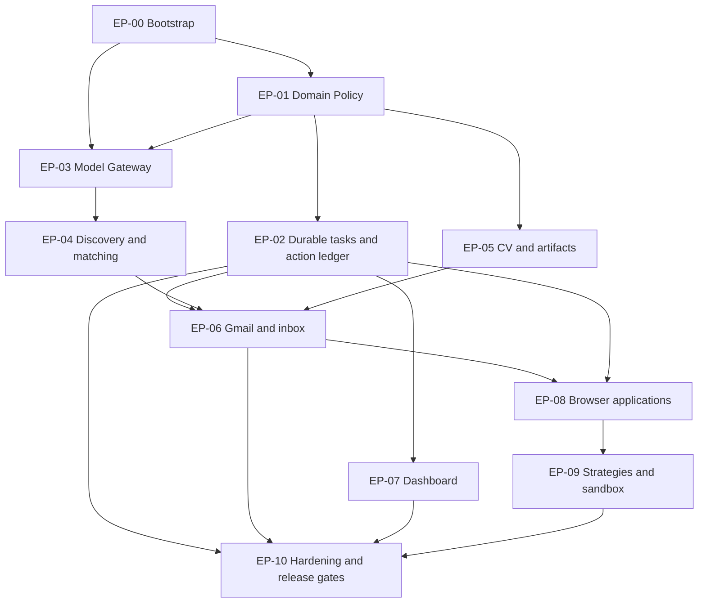

# Autonomous Career Opportunity Agent (ACOA)
## L4 — Implementation Plan and Acceptance Framework / Uygulama ve Doğrulama Planı

| Meta | Değer |
|---|---|
| Doküman kodu | `ACOA-L4-PLAN` |
| Sürüm | `v0.2` — paket öncelikleri, dikey dilimler ve Codex görev devri netleştirildi |
| Tarih | `2026-10-14` |
| Durum | **L4 GELİŞTİRME PLANI v0.2 — inceleme/uygulama devri için taslak; ayrıca nihai onay verilmedi, kodlama başlamadı** |
| Girdiler | L0 vizyonu, L1 onayı, **L2 v0.3 onaylı gereksinimler**, **L3 v1.0 onaylı ADR-001…ADR-015** |
| Kapsam | Codex için modüler iş paketleri, bağımlılıklar, test ve güvenlik kapıları, sürümleme |
| Kapsam dışı | Gerçek secret/kimlik bilgisi, üretimde doğrudan başvuru, kullanıcı CV'sinin tahmin edilmesi |

> **L0–L4 doküman seviyeleri ile T0–T3 model işlem sınıfları farklıdır.** Aşağıdaki geliştirme fazları da bu seviyelerden ayrı bir isimlendirmedir.

## 1. Başlangıç prensipleri

1. Geliştirme tek Python deposunda **modüler monolit** olarak yapılır; gerekirse API, worker, browser ve sandbox süreçleri ayrılır (`ADR-001`, `ADR-012`).
2. Görev, başvuru, işlem, bütçe ve izin gerçekleri yalnız ACOA'ya özel **bağımsız PostgreSQL servisinde** saklanır (`ADR-002`, `ADR-003`, `ADR-013`).
3. Model çağrıları merkezi AI Gateway ve Model Router üzerinden yürür. Araç yetkileri LLM çıktısından değil Policy Gate'ten gelir (`ADR-004`, `ADR-006`, `ADR-015`).
4. **Başlangıç varsayılanı: `dry_run=true`, `external_actions_enabled=false`.** Bir insan veya Codex’in test aracı gerçek şirkete yanlışlıkla gönderim yapamaz.
5. Her geliştirme görevi **küçük, bağımsız ve doğrulanabilir alt görevlere** bölünür. Codex önce plan + etki analizi + test kriterlerini yazar; sonra uygulama → test → diff inceleme → PR akışını izler.
6. L2 `F-xx.yy` / `E-xx.yy`, karar `P-01…P-22` ve `K-01`, L3 `ADR-xxx` kimlikleri task/PR/test izlerinde kullanılır. Yeni bir karar gerektiğinde varsayım yerine ADR veya kullanıcı kararı kaydedilir.
7. Kullanıcı profilindeki doğrulanmamış başarı/beceri CV'ye giremez; gelen yanıtlara cevap ve takip e-postasını yalnız kullanıcı gönderir.
8. Bilinmeyen veya belirsiz dış gönderim sonuçlarında otomatik retry yoktur.

## 2. Mimari uygulama katmanları ve sahiplik

| Katman | Sahip olduğu mantık | Sahip olmadığı mantık |
|---|---|---|
| Domain | İş kuralları, onaylı veri, geçişler, identity/idempotency kuralları | HTTP, Gmail, browser, LLM SDK |
| Application | Use-case, görevler, planlar ve durum koordinasyonu | Kalıcı adapter implementasyonlarının ayrıntıları |
| Intelligence | Model/effort yönlendirme, kalite değerlendirme, prompt şemaları | Yetki kararı veya doğrudan harici submit |
| Infrastructure | PostgreSQL, kaynak, e-posta, browser, artifact, sandbox adaptörleri | Ürün politikalarının yeniden tanımlanması |
| Policy & Executor | Dış eylem kontrolü, izin, kota, bütçe ve kanıt doğrulama | Serbest metin LLM talimatıyla yetki verme |
| Interfaces | FastAPI, HTML/JS dashboard ve yönetim API | Tüm iş mantığını endpoint içine toplamak |

## 3. Önerilen geliştirme sırası ve iş paketleri

### EP-00 — Repository, CI ve proje iskeleti

**Amaç:** Kapsamlı özellik geliştirmeden önce yeniden üretilebilir çalışma ortamı kurmak.

- `EP-00.01` Tek repo, Python paket tanımı, linter/formatter/type checker/test dizinleri; gerçek `.env` Git'e dahil edilmez.
- `EP-00.02` Uygulama konfigürasyon şeması, güvenli örnek konfigürasyon, dry-run ve deny-by-default kontrolleri.
- `EP-00.03` Yerel/bulut için aynı imajı kullanan Docker Compose, ACOA'ya özel PostgreSQL container/volume.
- `EP-00.04` CI: unit + statik kontroller + secret scanning + bağımlılık kontrolü.

**Kabul kapısı:** Temiz ortamda repo kurulumu/testler çalışır; hiçbir canlı gönderim yetkisi etkin değildir; başka proje veritabanına erişim yoktur. **Bağımlılık:** yok.

### EP-01 — Domain, doğrulanmış profil ve politika

- `EP-01.01` User goals, hard constraints, kaynaklı profil gerçekleri ve onay workflow'u; kullanıcı onayı olmadan yeni iddia doğrulanmış hâle gelmez.
- `EP-01.02` `AuthorizationGrant`, paylaşım kategorileri, geçerlilik/iptal, `user_sends`/`approval_required`/`auto_allowed` karar modelleri.
- `EP-01.03` `PolicyGate` saf, deterministik değerlendirme; negatif testler: opt-out, izin yokluğu, bütçe yokluğu, alıcı kapsamı dışı, hassas belge.
- `EP-01.04` Policy version ve karar gerekçe kodları; doğrulanabilir test matrisleri.

**Kabul kapısı:** Yanıt/takip otomatik gönderimi politika seviyesinde her zaman reddedilir; belirsiz izin `BLOCK/NEED_USER` olur. **İzler:** F-01/F-12, E-06/E-07, P-01/P-02/P-05/P-17/P-18, ADR-006.

### EP-02 — Kalıcı görev motoru, uygulama kaydı ve işlem protokolü

- `EP-02.01` PostgreSQL migration + task queue, lease, retry-policy, `waiting_user`, crash-safe reclaim.
- `EP-02.02` Application ledger; ilan/şirket kanonik kimliği, reapplication episode ve semantic key.
- `EP-02.03` `PreparedAction` → `ReservedAction` → `ExecuteOnce` → `Reconcile` durum makineleri; atomik izin/kota/bütçe recheck ve kayıt.
- `EP-02.04` `unconfirmed` durumlarında tekrar engeli, gönderim kanıtı modeli ve incident kaydı.
- `EP-02.05` Paralel worker, kill/restart ve dış sağlayıcı timeout için hata enjekte edilmiş testler.

**Kabul kapısı:** İki worker aynı semantik başvuruyu eşzamanlı gönderemez; timeout sonrası otomatik ikinci gönderim yok; DB yeniden başlatıldığında güvenli devam edilir. **İzler:** F-08/F-10, E-03/E-04/E-05, P-11/P-15/P-21, ADR-002/003/007/013.

### EP-03 — ModelGateway, ModelRouter, kanıt ve uygunluk değerlendirme

- `EP-03.01` `ModelGateway` ve fake provider; çağrılar için yapılandırılmış giriş/çıktı sözleşmeleri, bütçe ledger'ı.
- `EP-03.02` T0/T1/T2/T3 yönlendirme, provider allowlist, kalite kapısı ve sınırlı escalation/fallback.
- `EP-03.03` Veri hassasiyeti filtreleri, prompt injection ayrımı, bağlam seçimi ve cache anahtarları.
- `EP-03.04` Kullanıcı hard exclusion ile dinamik çok ölçütlü eşleştirmeyi ayrı aşamalar hâlinde test et.
- `EP-03.05` Etiketli ilanlardan kalite/yanlış eleme, token ve birim maliyet testleri.

**Kabul kapısı:** T0 görevinde model çağrısı yok; bütçe aşılamaz; izin verilmeyen provider'a PII gönderilemez; kalite yetersizse yalnız sınırlı yükseltme olur. **İzler:** F-05, E-01/E-02/E-06/E-12, P-03/P-10, ADR-004/015.

### EP-04 — Şirket ve fırsat keşfi / risk doğrulama

- `EP-04.01` İzinli arama/API/HTTP adaptörleri; kaynak snapshot, güncellik, köken ve kanonik ID.
- `EP-04.02` İlanlı/ilansız fırsat ve kurumsal kişi/kanal araştırması; kişisel özel e-posta kullanımına engel.
- `EP-04.03` Risk bazlı işveren doğrulama, sahte portal işaretleri, şirket bazlı opt-out.
- `EP-04.04` Çoklu kaynaklardan tekilleştirme, kaynak erişimi reddedildiğinde alternatif strateji.

**Kabul kapısı:** Aynı ilan ve aynı kurum farklı URL ile tekrarlanmaz; şüpheli alıcı kullanıcının kararını bekler; kaynak ve lisans/erişim politikaları kaydedilir. **İzler:** F-02/F-03/F-04/F-06, P-07/P-08/P-16, ADR-005/006.

### EP-05 — CV ve belge üretimi / artifact yaşam döngüsü

- `EP-05.01` Doğrulanmış profil iddiası referanslarını içeren CV/ön yazı oluşturma ve form sorusu yanıtları.
- `EP-05.02` Bilinmeyen kişisel sorular: yalnız ilgili başvuruyu `waiting_user` konumuna al.
- `EP-05.03` Değişmez artifact sürümlemesi, SHA-256, DB metadata bağı ve taşınabilir storage arayüzü.
- `EP-05.04` Artifact gizlilik/retention kuralları, dosya bozulma ve backup/restore testleri.

**Kabul kapısı:** Onaysız yeni beceri CV'ye giremez, iki başvuru farklı CV sürümlerini güvenilir biçimde referanslar; bilinmeyen maaş yanıtı uydurulmaz. **İzler:** F-01/F-07, E-05/E-06, P-05/P-06/P-18/P-20, ADR-008.

### EP-06 — Gmail adaptörü, inbox ve yalnız taslak iletişim

- `EP-06.01` Provider-neutral mail arayüzü ve fake adapter; ilk gerçek provider: Gmail API, minimum OAuth izinleri.
- `EP-06.02` Polling cursor, yinelenen gelen olay engeli, kesinti sonrası e-posta uzlaştırması.
- `EP-06.03` Başvuru e-postası hazırlama, taslak cevap ve taslak takip; kullanıcı gönderimi dışındaki yollar Policy Gate'te reddedilir.
- `EP-06.04` Test mailbox'ta ilk gönderim kabul/timeout/kanıt farkı; mail thread id ve sent id ilişkilendirmesi.
- `EP-06.05` Önemli yanıt bildirimi, günlük rapor; bildirim tekilleştirmesi.

**Kabul kapısı:** İlk e-posta sadece izinli sınırda gönderilebilir; yanıt/takip kullanıcının yerine gitmez; yeni mail yinelenmesi ikinci bildirim yaratmaz. **İzler:** F-09/F-11, E-04/E-07/E-08, P-01/P-02/P-09/P-12, ADR-009/014.

### EP-07 — Merkezi Dashboard ve kullanıcı kontrolleri

- `EP-07.01` FastAPI ve HTML şablonları; başvuru, şirket, görev, kullanıcı beklemeleri, maliyet ve performans görünümü.
- `EP-07.02` İzin, kota, bütçe, safe-mode, duraklat/devam/iptal kontrolleri ve sunucu tarafı auth/CSRF.
- `EP-07.03` Polling ile güncel durum, JSON/audit olaylarından maskeleme ve gündelik rapor.

**Kabul kapısı:** Kendi kendine gönderimi kapatma anında devredilir; arayüz gerçek kayıtları yansıtır; gerçek secret/PII loglarda görünmez. **İzler:** F-12, E-08/E-11, P-09/P-17/P-22, ADR-010.

### EP-08 — Web başvuru ve hesap açma: ayrı browser-worker

- `EP-08.01` Playwright tabanlı browser adaptör sözleşmesi; form alanı tespiti, doğrulanmış CV upload, kullanıcı devri.
- `EP-08.02` Risk bazlı browser worker izolasyonu ve sadece görev için gerekli yetkiler; dış işlem merkezi executor ile yürür.
- `EP-08.03` İzinli güvenilir kariyer hesabı oluşturma, benzersiz secret referansları ve MFA/CAPTCHA'ya kullanıcı devri.
- `EP-08.04` Test sitesi üzerinde hata enjeksiyonu; browser submit timeout sonucu unconfirmed ve recheck.
- `EP-08.05` Gerekli ve yararlı olduğunda AI-guided browser adapter; Browser Use zorunlu değil.

**Kabul kapısı:** Bilinmeyen sitede yanlış alan/izinsiz upload yok; script/browser worker Policy Gate'i atlayamaz; CAPTCHA aşılmaz. **İzler:** F-08, E-04/E-07/E-10, P-06/P-07/P-11/P-19, ADR-005/006/007/012.

### EP-09 — Deneyler, stratejik otonomi ve sandbox

- `EP-09.01` Strateji hipotezi, kohort/limit/ölçüm ve rollback mekanizması.
- `EP-09.02` Kontrollü A/B veya karşılaştırmalı değerlendirme; etki limiti ve kullanıcı hedefi sabit.
- `EP-09.03` AI tarafından üretilen kısa ömürlü Python yardımcı scriptleri için ağ/secret/FS kısıtlı sandbox.
- `EP-09.04` Geçici scriptlerin yetkili eylem kanallarına yalnız doğrulanmış, aracılı çıktı önerebilmesi.

**Kabul kapısı:** Strateji deneyi cevap/takip mailini otomatikleştiremez; sandbox scripti ana kodu/secret'ı değiştiremez; kontrol ve geri dönüş mümkündür. **İzler:** E-03/E-07/E-09/E-12, P-13/P-14, ADR-012/015.

### EP-10 — Taşınabilirlik, güvenilir işletim ve gerçek gönderim açma kapısı

- `EP-10.01` Yerel ve VPS ortamında aynı imajlarla kurulum; iki aktif worker riskine karşı taşıma prosedürü.
- `EP-10.02` ACOA DB volume + artifact volume birlikte yedekleme, geri yükleme ve SHA-256 doğrulama.
- `EP-10.03` Health checks, error budget/alert, dependency failure safe-mode, graceful shutdown.
- `EP-10.04` Kullanıcıya ait gerçek profil/hedef/izin/kanal/kota/bütçe konfigürasyonlarının eksiksiz doğrulanması.
- `EP-10.05` Pilot kanalda ve yalnız kullanıcı kontrollü test hedeflerinde canlı gönderim provası; kanıt/tekrar/iptal testi.
- `EP-10.06` Üretim açma için kullanıcı tarafından açık aktivasyon; inceleme sonrasında sınırlı izinli başlangıç.

**Kabul kapısı:** Kritik risk testleri geçmezse gerçek başvuru **kapalı** kalır. Kullanıcı onayı, geçerli kota/bütçe ve hizmet koşulları olmadan `external_actions_enabled=true` yapılamaz. **İzler:** E-04/E-07/E-08/E-11, P-04/P-10/P-11/P-17/P-20/P-21, ADR-011/013.

## 4. Kritik bağımlılıklar ve geliştirme grafiği

**Paralellik:** EP-03, EP-04'ün veri sözleşmesi hazırlığı ve EP-05'in şablon geliştirmesi uygun düzeyde paralel olabilir; API/sözleşme sınırları tamamlanmadan dış eyleme geçilmez. Test/mock/fake providerlar gerçek hesap olmadan çalışabilir.

## 5. Codex için standart iş paketi şablonu

Her iş paketi/alt görev için şu alanlar **zorunlu**:

| Alan | Açıklama |
|---|---|
| `Task ID` | Örn. `EP-02.03` |
| `Goal` | Tamamlandığında gözlemlenebilir davranış |
| `Scope / Non-goals` | Değiştirilecek modüller ve dokunulmayacak konular |
| `Inputs / Outputs` | Şemalar, state, veri sınırları |
| `L2 / ADR Trace` | `F-/E-`, `P-`, `ADR-` kimlikleri |
| `Subtasks` | Plan modunda küçük bağımsız uygulama adımları |
| `Acceptance criteria` | Otomatik veya manuel doğrulanabilir koşullar |
| `Tests & Fakes` | Gerekli unit/integration/contract/e2e testleri |
| `Failure cases` | Timeout, missing data, permissions, budget, duplicate |
| `Security / Cost Impact` | Harici eylem, PII, LLM ve kaynak etkisi |
| `Diff / PR Summary` | Değişikliklerin sınırı, test sonucu, geri dönüş notu |

**Kod stili:** Single-responsibility, küçük fonksiyonlar, erken giriş doğrulaması/early return, DRY/KISS/YAGNI, mevcut helper'ların yeniden kullanımı, minimal yorum, davranış koruma, test ve kısa odaklı PR. Kullanıcı iletişimi Türkçe; kod, identifier, yorum/docstring/log ve geliştirici tanı metinleri İngilizce (var olan public interface'ler değiştirilmez).

## 6. Ortam ve izin politikaları

- Geliştirme, test, üretim konfigürasyonları birbirinden ayrılır. Repo'ya gerçek `.env`, OAuth token, CV ve kişisel e-posta içerikleri girmez.
- Codex Cloud gibi geliştirme ortamına gerçek posta hesabı veya üretim secret'ı erişimi verilmesi varsayılan değildir. CI testleri fake adapterlar ve anonymize fixture'lar üzerinde çalışır.
- Testten canlıya geçiş ayrı ve açık bir eylemdir; sistem `dry_run` modunda anlamlı şekilde test edilebilir.
- E-posta izinleri minimum gerekli OAuth scope ve kullanıcı yetki sınırları ile uygulanır.
- Web kaynaklarının erişim politikaları, gönderim sınırları ve iletişim izinleri her provider adaptöründe denetlenir.

## 7. Tamamlanma kapıları: sprint değil kalite esaslı

| Kapı | Gerekli kanıt | Canlı dış eylem durumu |
|---|---|---|
| G0 — Bootstrap | Paket kurulumu, DB connectivity/health, migration altyapısı (şema migrasyonları EP-02’de), temel testler, güvenli varsayılan | Kapalı |
| G1 — Domain & Policy | Yetki/mükerrer/PII testleri | Kapalı |
| G2 — Orchestration | Crash, lease, unknown-submission, recheck testleri | Kapalı |
| G3 — Dry-run End-to-End | Şirket bul → eşleştir → CV → hazırla → kayıt → rapor, fake provider | Kapalı |
| G4 — Kontrollü pilot | Kullanıcının kontrolündeki mail kutusu ve başvuru test sitesinde gerçek provider handshake | Yalnız test hedefi |
| G5 — İlk gerçek gönderim | Kullanıcıdan gerçek yetki + limitler + kanıt + güvenlik testlerinin kabulü | Sınırlı açılır |
| G6 — Web / Learning | Browser ve sandbox güvenliği, strateji karşılaştırma ve rollback | Ayrı ayrı açılır |

**Bloklayıcı koşullar:** Yanıt/takip mailini agent'ın kendisi gönderiyorsa; AI scripti secret'a ulaşabiliyorsa; bütçe/kota aşılıyorsa; unknown submission ikinci kez otomatik yollanıyorsa; yanlış veri kategori izniyle CV/ek belge paylaşılıyorsa sürüm reddedilir.

## 8. L4 henüz netleşecek değerler

- Kullanıcı hedefleri: pozisyonlar, ülke/şehir/remote, çalışma koşulları, hard exclusions.
- Onaylı profil ve paylaşılabilir belge kategorileri.
- Gerçek Gmail hesabı/OAuth yapılandırması; izinli ilk temas kanalları.
- Başvuru/kişi/şirket üst limitleri, bütçe ve zaman sınırları, retry/cooldown.
- Saklama süreleri, günlük rapor ve önemli bildirim kanalları.
- İlk gerçek pilot şirket/site seçimi, değerlendirme kalitesi ve metrik eşikleri.

Bu değerler kullanıcıdan şimdi zorunlu olarak toplanmaz; konfigürasyon/gerçek gönderim kapısına kadar `TBD` kalabilir, ancak `TBD` hiçbir zaman sınırsız izin sayılmaz.

## 9. L4 taslağı kabul değerlendirmesi

- [ ] İş paketlerinin sırası ve bağımlılıkları uygun mu?
- [ ] L2 `S-01…S-41` uçtan uca senaryoları uygulama testlerine eşlenmiş mi?
- [ ] Kritik eylem güvenliği testleri tek tek mi, yoksa gereksiz birleşik test mi?
- [ ] Her bileşenin modül ve uyumluluk sınırı net mi?
- [ ] Kullanıcı politika ve izinleri tasarımda eksiksiz mi?
- [ ] Yerel/bulut kurulum bağımsızlığı doğrulanacak mı?
- [ ] Geliştirme sırları ile üretim sırları ayrıldı mı?

**Durum:** L4 uygulama planı, L3'te onaylanmış teknik tasarımı hayata geçirmeye yönelik ilk taslaktır. Henüz bir repo oluşturulmadı, kod yazılmadı, gerçek başvuru gönderilmedi.

---

## 10. v0.2 konsolidasyon ve denetim notları

**Onay durumu:** L0, L1, L2 v0.3 ve L3 v1.0 onaylı temeldir. L2 v0.3 dosyasındaki eski “henüz onaylanmadı” metni, bu belgeden sonra verilen açık kullanıcı onayı nedeniyle güncelliğini yitirmiştir; bu bir **belge statüsü düzeltmesidir**, gereksinim değişikliği değildir. Bu L4 v0.2 belgesi ise henüz ayrı onaylanmış sayılmaz.

**v0.1’den korunanlar:** 11 EP (`EP-00…EP-10`), 168 L2 gereksinimin izlenebilirliği, 41 L2 uçtan uca senaryosu, 15 onaylı ADR, 7 kalite kapısı ve `dry_run=true/external_actions_enabled=false` başlangıcı.

**v0.2 iyileştirmeleri:**

1. **G0 önkoşulu düzeltildi:** EP-00, Alembic/migration altyapısını hazırlayabilir fakat gerçek uygulama şemalarının tamamını EP-02’den önce gerektirmez. G0 bunun üzerinden bloklanamaz.
2. **EP-10 tek parça son aşama olmaktan çıkarıldı:** Güvenlik/backup/health/recovery konuları ilgili iş paketlerinde kademeli geliştirilir; EP-10 final bütünleştirme ve gerçek gönderim aktivasyonunun sahibi olarak kalır.
3. **EP-07 erkene alındı:** Görev ve politika kayıtlarını izleyen minimum yönetim görünümü EP-02 sonrasında başlayabilir. EP-06’yı beklemek zorunda değildir.
4. **EP-09 pilotu bloke etmez:** Kontrol edilen e-posta başvurusunu test etmek için kendi kendine araç geliştirme ya da geniş stratejik öğrenme gerekli değildir. Bunlar daha sonra, ayrı bir yetki/kalite kapısıyla etkinleştirilir.
5. **Harici işlem sınırı açık:** İlk e-posta/form gönderimi ve hesap yaratılması Policy Gate + Executor ile; gelen yanıtlara cevap ve takip e-postaları yalnız kullanıcı tarafından gönderilir.
6. **Kod üretiminde kaynak güvenliği:** Codex’e gerçek CV, Gmail token, e-posta geçmişi veya üretim `.env` verilmez. Test verileri sentetik olmalıdır.

## 11. Geliştirme modeli: dikey dilimler, bağımsız PR’lar

İş paketleri **mantıksal sahiplik alanlarıdır**, bire bir sprint veya tek PR değildir. İnşa stratejisi, test edilebilir küçük dikey dilimlerdir. Her adımda bir önceki çalışan durum korunur.

| Dilim | Minimum çalışan çıktı | Gereken EP kapsamı | Canlı gönderim | Kabul |
|---|---|---|---|---|
| **S0 — Güvenli iskelet** | Kurulabilen Python paketi, test altyapısı, konfigürasyon, ACOA'ya özel DB konteyneri | EP-00 | **Yok** | G0 |
| **S1 — Politikaların çalışması** | Onaylı profil iddiaları, izin/veri paylaşım sınırları, sürümlü Policy Gate | EP-01 | **Yok** | G1 |
| **S2 — Güvenilir iş motoru** | Kalıcı görev ve işlem kayıtları, leasing, `unconfirmed`, eşzamanlılık testleri | EP-02 + erken EP-07 | **Yok** | G2 |
| **S3 — Sentetik uçtan uca başvuru** | Test ilanı → doğrulama/uygunluk → CV → hazırlanmış işlem → kayıt + dashboard | EP-03/04/05 + erken EP-07 | **Yok** | G3 |
| **S4 — Kontrollü e-posta pilotu** | Test hesabında Gmail adaptörü, yalnız yetkili **ilk** gönderim, uzlaştırma, inbox taslağı | EP-06 + EP-10'un ilgili güvenlik/kurtarma parçaları | **Yalnız kontrol edilen test alıcısı** | G4 |
| **S5 — Kullanıcı yetkili ilk gerçek temas** | Hazırlanmış gerçek profil/izin/bütçe ve kanıt mekanizmasıyla sınırlı başlangıç | EP-06/07 + EP-10 aktivasyon kapısı | **Yalnız kullanıcı izin verdiyse** | G5 |
| **S6 — Web başvurusu** | Ayrı browser-worker, test kariyer formu, CV upload ve güvenli gönderim | EP-08 | Ayrı kanal yetkisine tabi | G6 browser |
| **S7 — Gelişmiş otonomi** | Deney/rollback ve izole geçici araçlar | EP-09 | Yeni yetki vermez | G6 learning |
| **S8 — Olgun operasyon** | Kurtarma provası, metrik kalibrasyonu, maliyet performansı | EP-10 tamamı | Mevcut yetki sınırları | Son kontrol |

**Önemli:** S5'te gerçek bir şirkete ilk başvuru yapılabilmesi için ayrıca açık kullanıcı aktivasyonu, önceden tanımlanmış izinler, kişisel veri kategorileri ve başvuru/bütçe limitleri gereklidir. Bu planın onaylanması bu izni vermez.

### 11.1. En küçük değişiklik birimi

Her Codex PR'ı: (a) tek somut sonuç, (b) kaynak kodu ve testleri birlikte, (c) sınırların dışına çıkmama, (d) kısa diff ve test özeti, (e) `F-/E-`, `P-`, `ADR-` izleri ile kapanmalıdır. Paralel geliştirme, önce modül API sözleşmesi onaylandıysa yapılabilir.

## 12. EP-00 için kesinleştirilmiş sıra (uygulama henüz başlamadı)

| Alt görev | Teslimat | Önkoşul | Kontrol / kabul |
|---|---|---|---|
| **EP-00.01** | GitHub/Codex için temel Python proje iskeleti; `src/acoa`, `tests`, `pyproject.toml`, `.gitignore`, `README`, `AGENTS.md` | Yeni/boş repo erişimi | `python -m pytest` ve linter temiz; dış ağ ve canlı eylem yok |
| **EP-00.02** | Yapılandırma modeli; varsayılan `dry_run=true`, `external_actions_enabled=false`, eksik izin/bütçe `deny` | EP-00.01 | Negatif güvenlik testleri; gerçek secret yok |
| **EP-00.03** | ACOA özel PostgreSQL container, bağımsız volume, healthcheck, yerel/bulut ortam değişkenleri, migration iskeleti | EP-00.02 | Ayrı servis/volume; DB erişim testi; başka proje DB'sine bağlanmama |
| **EP-00.04** | CI, kalite araçları, bağımlılık/secret kontrolleri, minimal log ve güvenli pipeline | EP-00.01/02/03 | Temiz checkout'ta test; hiçbir gerçek gönderim veya gizli anahtar yok |

İlk çalışılacak PR yalnızca **EP-00.01** olacaktır. Veritabanı şemaları, API endpoint'leri, gerçek AI/Browser/Gmail entegrasyonları ve hesap açma bu PR'ın kapsamı dışındadır.

### 12.1. EP-00.01 için sabit kabul kriterleri

- `src` düzeninde kurulabilen minimal Python paketi ve sürümlenmiş proje metadata'sı bulunur.
- `README.md` kurulum, test ve geliştirme politikalarını açıklar; `AGENTS.md` onaylı mimariyi, Codex çalışma şeklini ve sır korumasını özetler.
- `pytest` ile en az bir anlamlı import/paket smoke testi çalışır; linter ve formatter kontrolleri çalışır.
- `.gitignore` `.env`, kimlik dosyaları, OAuth token'ları, kişisel CV/özgeçmişler, test ve log çıktıları için koruma sağlar. Örnek `.env.example` gerçek değer içermez; EP-00.02'de ayrıntılandırılabilir.
- Kod/yorum/log/teknik belge İngilizce, kullanıcıya açıklama Türkçe; küçük fonksiyonlar ve görev kapsamına uygun değişiklikler.
- Kodda gerçek dış eylem, gerçek network isteği, servis API anahtarı veya kendiliğinden çalışan zamanlayıcı yoktur.
- Codex mevcut repo içeriğine saygı gösterir; başlangıçta boş olmadığı anlaşılırsa öncelikle inceleme yapar ve ilgisiz dosyaları silmez.

### 12.2. EP-00.01 negatif test/failure listesi

- Gerçek `.env`, credential veya token dosyası `git` içine eklenemez.
- `pytest` kullanıcı bilgisayarının Gmail/DB kimlik bilgilerini gerektirmez.
- Paketin import edilmesi dış kaynak çağrısı veya otomatik başvuru tetiklemez.
- CI her çalışmada gerçek sağlayıcıya bağlanmak zorunda değildir.
- Kod deposundaki ilk commit'te otomatik gönderim açık olamaz.

## 13. Devam eden PR'lar için kritik görev sözleşmeleri

| Dönüm noktası | Çalışma sözleşmesi | Zorunlu test örneği |
|---|---|---|
| **Policy Gate (EP-01)** | Karar çıktısı yapılandırılmış `ALLOW / BLOCK / NEED_USER / RECHECK`, asla LLM metninden yetki türetilmez | Kullanıcı gönderecek türlerde `BLOCK`, paylaşım izni eksikse `BLOCK` |
| **Task queue (EP-02)** | Lease/claim atomik, görev ve dış eylem sonuçları ayrık | Worker kill & crash, double claim engeli |
| **External Action (EP-02)** | Prepare → Reserve → Execute Once → Reconcile | Timeout → `unconfirmed`; otomatik ikinci submit yok |
| **Model Router (EP-03)** | Deterministik T0 yolu önce; ihtiyaçta bütçeli T1–T3 | T0: 0 model çağrısı; bütçe tükenince ücretli istek yok |
| **Company verification (EP-04)** | Kaynaklı şirket kimliği ve kanal riski | Sahte domain/kişisel adres/silinmiş ilan için güvenli sonuç |
| **CV pipeline (EP-05)** | Onaylı iddia ID'si ile artefakt sürümü bağlanır | CV'ye uydurma beceri ve izinsiz hassas bilgi giremez |
| **Gmail (EP-06)** | Provider-neutral, önce Gmail polling, yalnız ilk temas otomatik | Yanıt/takip asla auto-send olmaz; event duplicate yok |
| **Dashboard (EP-07)** | Operasyonel kontroller backend politikasını kullanır | Pause/disable sonrası yeni dış eylem engeli |
| **Browser (EP-08)** | İzole worker, tek yetkili executor | CAPTCHA/MFA atlanmaz; bilinmeyen form `waiting_user` |
| **Sandbox (EP-09)** | Secret/ağ/repo erişimi default deny | Üretilmiş kodun mail göndermesi veya ana kodu değiştirmesi engellenir |
| **Production (EP-10)** | Yetki/kota/bütçe/kanıt/backup şartları dolmadan canlı yok | Backup/restore, safe-mode ve manuel aktivasyon provası |

## 14. Kapsam/güvenlik sınırları ve değişiklik yönetimi

- **İlk canlı eylem onayı ayrıca alınır.** Mimari veya proje planı onayı otomatik e-posta gönderme yetkisi değildir.
- Kullanıcı hedefleri, veri izinleri, limitler ve politika sürümleri görev başladığı anda ve eylem anında kontrol edilir.
- Kullanıcıdan alınmamış sayısal bütçe veya başvuru limiti *otomatik sınırsız* kabul edilemez.
- Dışarıdan okunan HTML/e-posta/LLM yanıtları güvenilmeyen girdidir; yazılım talimatı yerine geçmez.
- Yeni modül veya agent oluşturulması ölçülebilir kalite, maliyet ve güvenilirlik yararı göstermelidir.
- Yetki, gizlilik veya gönderim semantiğinde değişiklik L2 etki analizi ve ADR revizyonu gerektirir; Codex bunları izinsiz değiştiremez.

## 15. Review kararı

**Hazır öneri:** `EP-00.01` Codex için uygulanabilir, güvenli ilk görevdir. L4 v0.2 **inceleme taslağıdır**, otomatik olarak onaylanmış sayılmaz. İlk görev tamamlandıktan sonra EP-00.02, EP-00.03, EP-00.04 sırasıyla geliştirilir; her aşamada test/PR/geri dönüş bilgisi istenir.
